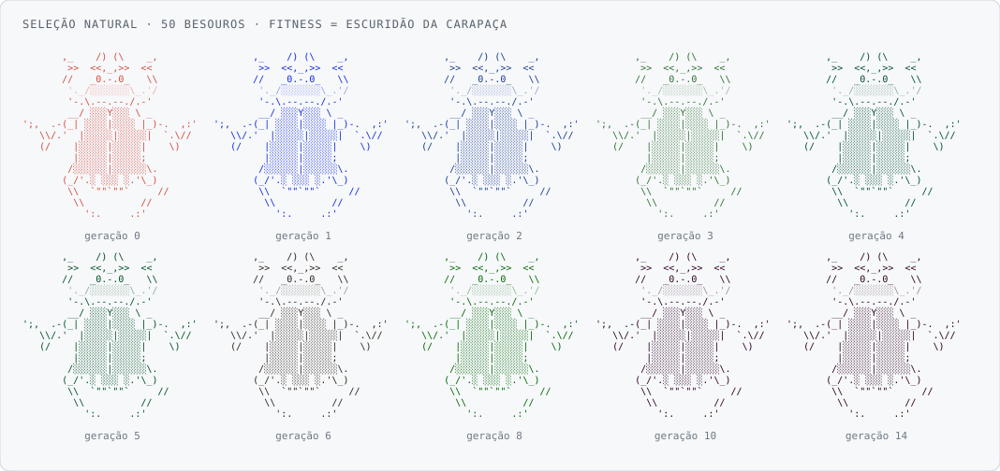

# GA - Beatle

Um algoritmo genético simples em Python que evolui uma população de besouros coloridos.

<p align="center">
  
</p>

## Como funciona

Cada besouro tem três genes: os canais **R**, **G** e **B** da cor da carapaça, entre 0 e 255.
O ambiente favorece os besouros mais escuros, então o fitness é:

```
fitness = 1 - (R + G + B) / 765
```

A cada geração:

1. **Seleção** por roleta: quanto maior o fitness, maior a chance de reproduzir.
2. **Cruzamento**: o filho herda canais de cor do pai e da mãe.
3. **Mutação**: com 10% de chance, um canal sofre uma variação aleatória.

A evolução para quando todos os besouros da população passam do fitness mínimo (0.55).
No fim, os sobreviventes são desenhados no terminal, cada um com a própria cor.

## Como rodar

```bash
pip install colr
python main.py
```

Para gerar de novo a imagem desta página:

```bash
python gerar_banner.py
```

## Estrutura

| Arquivo | Conteúdo |
|---|---|
| `G.py` | Indivíduo, população, seleção, cruzamento e mutação |
| `main.py` | Loop de gerações e desenho dos besouros no terminal |
| `gerar_banner.py` | Gera `assets/besouros.svg` |
